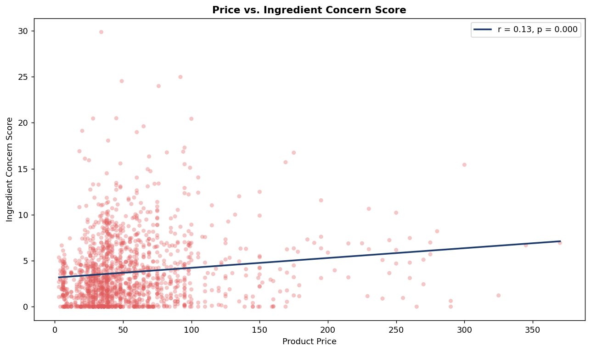
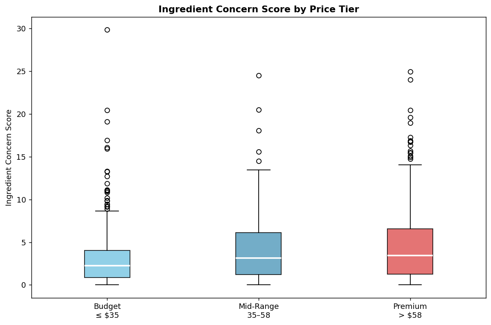
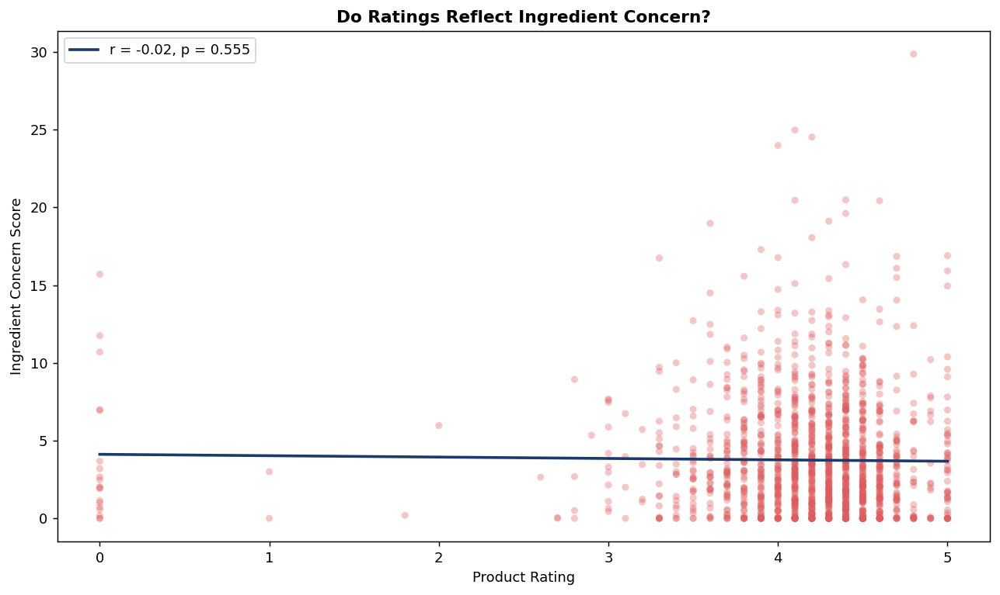
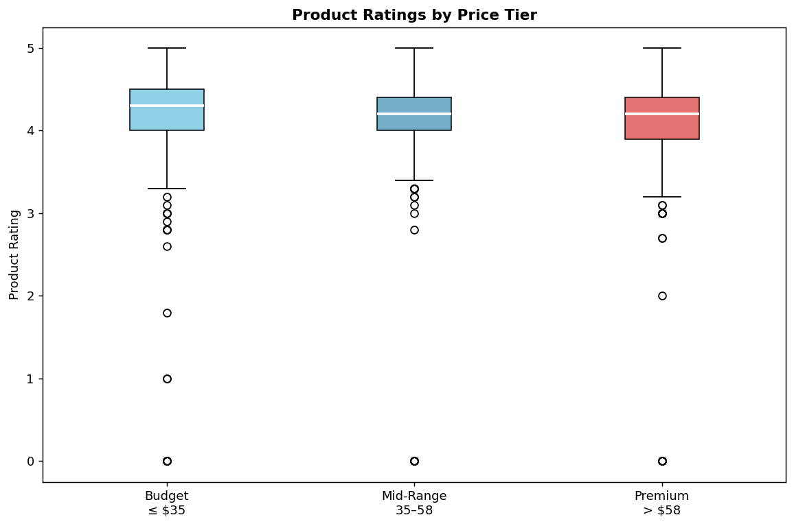

# Beyond Price Tags

**Do price and ratings reflect ingredient concern in skincare products?**

A data science project analyzing ~1,400 Sephora skincare products to test whether
higher price or higher customer ratings actually correspond to lower-concern
ingredient formulations.

*Human-Centered Data Science, Assignment 4. Author: Aashma Varma.*

---

## Motivation

Formulation quality is something the average shopper cannot evaluate at the point of
purchase. Ingredient lists are public but hard to interpret, so people fall back on
external cues, mainly price and brand, and consumer-behavior research shows
people tend to associate higher prices with higher quality. That heuristic matters most
for non-durable goods like skincare, where quality is hard to judge before buying.

This project asks whether that assumption holds up: does paying more, or trusting a high
star rating, actually get you a lower-concern formulation?

## Research questions

1. Do higher-priced products have lower ingredient concern scores?
2. Do higher-priced products receive higher ratings regardless of concern score?

**Hypothesis:** premium products show lower concern scores and maintain high ratings.

## Method in brief

**1. Product data:** A Kaggle dataset of 1,400+ Sephora skincare products (price, rating,
category, ingredient list), reflecting a 2023 snapshot. 134 products had missing
ingredient lists; 77 were recovered by scraping [INCIdecoder](https://incidecoder.com),
and ~10–12 were dropped where no data was available.

**2. Flagged-ingredient list:** A hand-built list of 50 ingredients commonly associated
with irritation, sensitivity, debated safety, or toxicological concern (drawn from CIR
reports and INCIdecoder). Each was assigned a severity score of 1 to 3. See
[`data/flagged/flagged_ingredients.csv`](data/flagged/flagged_ingredients.csv).

**3. Concern score:** For each product, every ingredient is checked against the flagged
list. Because ingredient lists are ordered by decreasing concentration, matches earlier
in the list count for more:

```
position_weight = max(0.05, (total_ingredients - position) / total_ingredients)
contribution    = severity × position_weight
concern_score   = Σ contribution  (over all flagged matches)
```

So fragrance (severity 2) listed 2nd out of 20 ingredients contributes far more than the
same fragrance listed 18th. Products are then split into **Budget / Mid-Range / Premium**
tiers at the 33rd and 67th price percentiles. Full detail on severity assignment,
position weighting, and statistics is in [`methodology.md`](methodology.md).

**Strengths and limitations of the score:** It is simple, interpretable, and
position-weighted, which makes it a reasonable *proxy* for formulation concern. But it
does not capture concentration, ingredient interactions, or the fact that some flagged
ingredients are used precisely because they improve stability, texture, or preservation.
A higher score does not mean a product is unsafe. Safety depends on concentration,
formulation, skin type, and usage.

## Findings

| # | Question | Result |
|---|----------|--------|
| 1 | Price vs. concern score | Very weak positive relationship (r = 0.12, p < 0.001). Price explains ~1.4% of variation (R² = 0.014). |
| 1b | Concern score by price tier | Low-to-moderate across all tiers; Premium does not consistently score lower than Budget. |
| 2 | Rating vs. concern score | No meaningful linear relationship (r ≈ 0.00). Concern varies widely even among 4–5 star products. |
| 3 | Rating by price tier | Ratings similarly high (median low-4s) across all tiers. |






**Takeaway:** Neither price nor rating reliably signals a cleaner formulation. Higher price
may reflect brand image, packaging, texture, or product experience rather than
lower-concern ingredients, and a star rating captures overall experience, not
formulation. The price-quality rule of thumb is not useless, but it should not be trusted
as a proxy for ingredient concern.

## Repository structure

```
skincare-concern-analysis/
├── README.md
├── methodology.md   # severity scoring, weighting, stats (the judgment calls)
├── requirements.txt
├── LICENSE
├── .gitignore
├── data/
│   ├── raw/          # cosmetics.csv: original Kaggle data (download separately)
│   ├── flagged/      # flagged_ingredients.csv: 50 ingredients + severity (core contribution)
│   ├── interim/      # scraper outputs + manual-review files (regenerable)
│   └── processed/    # combined_cosmetics + results_with_concern_scores
├── src/
│   ├── data_cleanup.py     # fill missing ingredient lists via INCIdecoder
│   ├── dataset_build.py    # merge cleaned + manually reviewed rows
│   └── analysis.py         # compute concern scores, stats, and plots
├── figures/          # the four analysis plots
└── presentation/     # slide deck (PDF)
```

## Reproducing the analysis

```bash
pip install -r requirements.txt
```

If you just want the results, the processed data is already included, so run only the last
step. To rebuild from scratch:

1. **Get the raw data:** Download `cosmetics.csv` from Kaggle into `data/raw/`
   (see [`data/raw/README.md`](data/raw/README.md)).
2. **Fill missing ingredients** *(optional, hits the network and is slow, about 2s/request)*:
   ```bash
   cd src && python data_cleanup.py
   ```
   Rows the scraper cannot resolve land in `data/interim/manual_review.csv`. Fill those in
   by hand, save as `manual_review_completed.csv`, then:
   ```bash
   python dataset_build.py
   ```
3. **Run the analysis** (reads `data/processed/combined_cosmetics.csv` and the flagged
   list; writes results + figures):
   ```bash
   cd src && python analysis.py
   ```

## Data & attribution notes

- Product data originates from a public Kaggle Sephora dataset. The raw `cosmetics.csv` is
  **not committed** (git-ignored). The slide-deck figures were produced from
  `cleaned_final_cosmetics.csv`; the repo ships the equivalent `combined_cosmetics.csv`
  built by `dataset_build.py` (see [`methodology.md`](methodology.md) §7). Note the
  processed CSVs still contain Kaggle-derived product fields; check the dataset's license
  before redistributing them further.
- `flagged_ingredients.csv` and all severity scores are the author's own compilation,
  informed by CIR reports and INCIdecoder.
- The dataset is a 2023 snapshot limited to US Sephora listings, so it under-represents
  brands popular in other markets (notably East Asia).

## Limitations

Data is regional (US Sephora) and time-bound (2023); ratings cluster at 4–5 stars, giving
little signal at the low end; and the concern score is a deliberately simple proxy that
ignores concentration and formulation context. Results describe *this dataset*, not the
skincare market as a whole.

## License

MIT. See [LICENSE](LICENSE).
